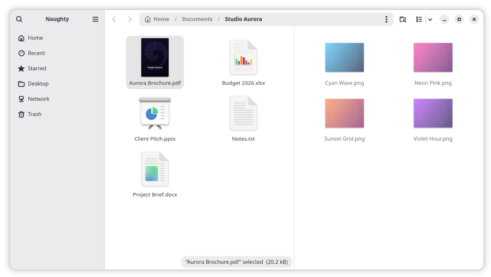
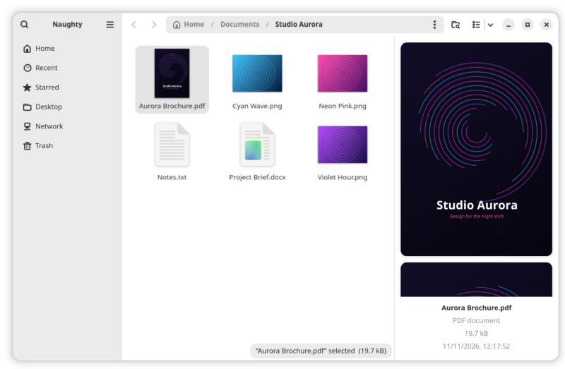
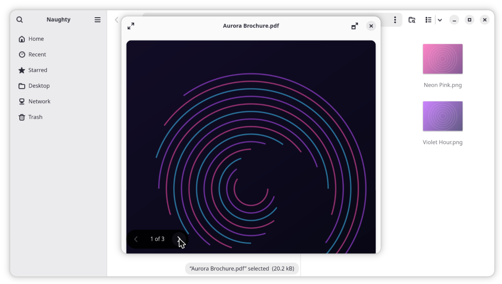

<p align="center">
  
</p>

<h1 align="center">Naughty</h1>

<p align="center">
  <b>The file manager you know from GNOME, plus what you miss from Finder and Windows Explorer.</b><br>
  Split view · preview pane · spacebar preview of PDFs and Office files · jump-to-file typing · a copy queue you can pause
</p>

<p align="center">
  <a href="https://github.com/niccostantini/naughty/releases/latest"></a>
  <a href="https://github.com/niccostantini/naughty/actions/workflows/deb.yml"></a>
  <a href="LICENSE"></a>
  
  
</p>

<p align="center">
  <a href="#what-it-adds">Features</a> ·
  <a href="#shortcuts">Shortcuts</a> ·
  <a href="#install">Install</a> ·
  <a href="#known-limits">Known limits</a> ·
  <a href="https://github.com/niccostantini/naughty/issues">Report a bug</a>
</p>

<p align="center">
  
</p>

Naughty is an unofficial fork of [GNOME Files (Nautilus)](https://gitlab.gnome.org/GNOME/nautilus) 50.
It keeps everything you know from Nautilus and adds the features people miss after using
Finder or Windows Explorer. It installs beside your system file manager, so you can try it
and remove it without touching the system.

## What it adds

### Two folders side by side

Press <kbd>F3</kbd> to open a second pane next to the current one, and drag files between
them. The inactive pane dims, so you always see which one you work in. <kbd>Ctrl</kbd>+<kbd>W</kbd>
in the second pane closes the split.

### A preview pane

Press <kbd>Alt</kbd>+<kbd>P</kbd> for a pane beside the files that shows the selected file:
PDFs and Office documents page by page, text files as text, images in full quality, and a
thumbnail for everything else, with name, type, size and date. Drag its edge to resize it;
it keeps its width and stays open until you close it.

<p align="center">
  
</p>

### Spacebar preview for documents

Select a file and press <kbd>Space</kbd>. PDFs open in a scrollable viewer with page buttons.
Word, Excel and PowerPoint files (`.docx`, `.xlsx`, `.pptx`, also ODF) get a full preview too.
It also works for files in the Trash, inside ZIP archives, on network shares (SMB, SFTP) and
on the Ubuntu desktop.

<p align="center">
  
</p>

### Jump to files while typing

Type the first letters of a name and Naughty selects the file, as in Finder and Windows
Explorer. Nautilus starts a search instead. <kbd>Ctrl</kbd>+<kbd>F</kbd> still searches, and a
switch in Preferences restores the old behaviour.

### A copy queue you can pause

Copies run one after another instead of all at once, so they do not slow each other down.
Each copy has a **Pause** button in the operations list. A switch in Preferences turns the
queue off.

### Its own face

A neon icon and its own name, so you never mix it up with the system Files.

### Shortcuts

| Keys | Does |
|---|---|
| <kbd>F3</kbd> | Open or close the split view |
| <kbd>Alt</kbd>+<kbd>P</kbd> | Show or hide the preview pane |
| <kbd>Space</kbd> | Spacebar preview of the selected file |
| *Type a name* | Jump to the first file that starts with it |
| <kbd>Ctrl</kbd>+<kbd>F</kbd> | Search |
| <kbd>Ctrl</kbd>+<kbd>W</kbd> | Close the second pane of the split view |

The spacebar previewer is a patched copy of GNOME Sushi:
[naughty-sushi](https://github.com/niccostantini/naughty-sushi).

## Is it for you?

Naughty is a good fit if all of these are true:

- You use **GNOME 50**. Naughty was built and tested only on **Ubuntu 26.04**.
- You are fine with a package from a personal GitHub page, not from Ubuntu's archive.
- You want these features more than a polished, supported product.

Naughty is a personal project. It does not follow GNOME's release schedule, and it has no
automatic updates: to get an email for each new version, click **Watch → Custom → Releases**
at the top of this page. Bugs belong in [this repository's issues](https://github.com/niccostantini/naughty/issues),
**never** in GNOME's bug tracker.

> [!WARNING]
> **Back up your files, and expect no warranty.** Naughty changes how files are copied and
> moved (the copy queue and pause). A bug could damage or lose files. Keep a backup of anything
> you cannot afford to lose. Naughty comes with no warranty of any kind, as stated in sections
> 15 and 16 of the [GNU GPL](LICENSE).

## Install

Download `naughty_<version>_amd64.deb` from the
[latest release](https://github.com/niccostantini/naughty/releases/latest), then install it:

```bash
sudo apt install ./naughty_*_amd64.deb
```

The package installs into `/opt/naughty` and adds the `naughty` command, a launcher in the app
grid and the spacebar previewer. It does not change the system Files app. The previewer has
its own name, so it can stay installed next to `gnome-sushi`, the previewer of the system Files
app. Version 50.5-naughty1 removed `gnome-sushi`; if you installed that version, install it
again with `sudo apt install gnome-sushi`.

Naughty now appears in your app grid, and `man naughty` lists its options. Open it, select a
PDF and press <kbd>Space</kbd>.

To make Naughty open your folders:

```bash
xdg-mime default io.github.niccostantini.Naughty.desktop inode/directory
```

To build the package yourself, install the dependencies of step 1 below and `dpkg-dev`, then
run `packaging/build-deb.sh` in a clone of this repository. It writes the `.deb` to
`build-deb/`. The same script runs on GitHub after every push and once a week, so a
[green badge](https://github.com/niccostantini/naughty/actions/workflows/deb.yml) means it
still builds against the current Ubuntu 26.04 packages.

### Build from source instead

> All of this installs into `~/.local`. It needs `sudo` only for the build dependencies.

**1. Install the build dependencies** (Ubuntu 26.04):

```bash
sudo apt install build-essential pkg-config gettext gjs gobject-introspection meson ninja-build git blueprint-compiler libgtk-4-dev libadwaita-1-dev libgdk-pixbuf-2.0-dev libglycin-2-dev libglycin-gtk4-2-dev libgnome-autoar-0-dev libgnome-desktop-4-dev libgstreamer-plugins-base1.0-dev libicu-dev libportal-dev libportal-gtk4-dev libtinysparql-dev libcloudproviders-dev libwayland-dev libgirepository-2.0-dev libpapers-dev libgtksourceview-5-dev libwebkitgtk-6.0-dev gir1.2-papers-4.0 gir1.2-gtksource-5 gir1.2-webkit-6.0
```

**2. Build Naughty:**

```bash
git clone https://github.com/niccostantini/naughty.git
cd naughty
meson setup build -Dextensions=false -Dselinux=disabled -Dtests=none --prefix="$HOME/.local/opt/naughty"
meson install -C build
```

**3. Build the previewer** (from the same `naughty` folder):

```bash
git clone https://github.com/niccostantini/naughty-sushi.git subprojects/sushi
meson setup subprojects/sushi/build subprojects/sushi -Dprofile=default --prefix="$HOME/.local/opt/naughty"
meson install -C subprojects/sushi/build
```

**4. Add a launcher, the icon and the previewer service:**

```bash
P="$HOME/.local/opt/naughty"
cat > "$P/bin/naughty" <<EOF
#!/bin/sh
export GSETTINGS_SCHEMA_DIR="$P/share/glib-2.0/schemas"
export XDG_DATA_DIRS="$P/share:\${XDG_DATA_DIRS:-/usr/local/share:/usr/share}"
exec "$P/bin/nautilus" "\$@"
EOF
chmod +x "$P/bin/naughty"
mkdir -p ~/.local/share/applications ~/.local/share/icons/hicolor/scalable/apps ~/.local/share/dbus-1/services
sed -e "s|^Exec=nautilus|Exec=$P/bin/naughty|" -e "s|^DBusActivatable=true|DBusActivatable=false|" "$P/share/applications/io.github.niccostantini.Naughty.desktop" > ~/.local/share/applications/io.github.niccostantini.Naughty.desktop
ln -sf "$P/share/icons/hicolor/scalable/apps/io.github.niccostantini.Naughty.svg" ~/.local/share/icons/hicolor/scalable/apps/
ln -sf "$P/share/dbus-1/services/io.github.niccostantini.Naughty.Previewer.service" ~/.local/share/dbus-1/services/
```

Naughty now appears in your app grid. Open it, select a PDF and press <kbd>Space</kbd>.

**5. Optional: make Naughty open your folders.**

```bash
xdg-mime default io.github.niccostantini.Naughty.desktop inode/directory
```

### Office previews

Office files need a converter. Naughty uses whichever of these it finds:

- **LibreOffice**, if it is installed.
- **OnlyOffice Desktop Editors** from the Snap Store (`sudo snap install onlyoffice-desktopeditors`).
  Open OnlyOffice once after you install it, so it builds its font list.

PDF previews work without either one.

## Uninstall

If you installed the package:

```bash
xdg-mime default org.gnome.Nautilus.desktop inode/directory
sudo apt remove naughty
```

Your preferences stay in dconf under `/io/github/niccostantini/Naughty/`.

If you built from source:

```bash
xdg-mime default org.gnome.Nautilus.desktop inode/directory
rm -rf ~/.local/opt/naughty
rm -f ~/.local/share/applications/io.github.niccostantini.Naughty.desktop ~/.local/share/icons/hicolor/scalable/apps/io.github.niccostantini.Naughty.svg ~/.local/share/dbus-1/services/io.github.niccostantini.Naughty.Previewer.service
```

Your system Files app was never changed, so it works as before.

## Known limits

- **Bundled extensions off.** Nautilus' own image-properties extension is not built, because
  Ubuntu 26.04 lacks `gexiv2` 0.16. Extensions installed on the system for Files still load,
  including that one from Ubuntu's package, `nautilus-python` scripts and cloud-sync menus.
- **Preview pane on local files only.** Files in the Trash, in archives or on network shares
  show a thumbnail in the pane; the spacebar preview still shows them in full. Audio and video
  show a thumbnail too. Converted Office documents are kept in `~/.cache/naughty/previews`.
- **Papers updates.** The preview pane uses Papers' C library, which has no stable API. A
  weekly build on GitHub catches most breaks early. If previews break after a Papers update,
  install a newer package or rebuild Naughty.
- **Previews of remote files make a copy.** Files from ZIP archives and network shares are
  copied to `~/.cache/sushi` before the preview. That folder is not emptied automatically.
- **Fresh settings.** Naughty keeps its own preferences, apart from the system Files. To start
  from your current Files settings, run this once:
  `dconf dump /org/gnome/nautilus/ | dconf load /io/github/niccostantini/Naughty/`

## Roadmap

- Miller column view, like Finder's column view
- File tags

## License and credits

Naughty is free software under the **GNU General Public License, version 3 or later**. See
[`LICENSE`](LICENSE). Almost all of the code is the work of the
[Nautilus contributors](https://gitlab.gnome.org/GNOME/nautilus/-/graphs/main). Their copyright
notices stay in the source files. Every change made for Naughty is a separate commit on top of
the upstream `gnome-50` branch, so you can see exactly what differs.

The previewer, [naughty-sushi](https://github.com/niccostantini/naughty-sushi), keeps GNOME
Sushi's license, GPL-2.0-or-later with the GStreamer exception (see its `COPYING`). Naughty also
includes a few helpers from xdg-desktop-portal-gnome (`xdp-gnome/`, LGPL-2.0-or-later). The
per-file licenses are listed in [`packaging/copyright`](packaging/copyright), which the .deb ships
as `/usr/share/doc/naughty/copyright`. Naughty does not include LibreOffice or OnlyOffice. It runs
the copy you installed, as a separate program.

Naughty is **not** made, endorsed or supported by the GNOME Foundation. "GNOME", "Nautilus"
and "Files" refer to the original project. The full-colour Naughty icon is original artwork made for
this fork, © 2026 Niccolò Costantini, released under GPL-3.0-or-later like the rest of Naughty. The
symbolic (monochrome) icon is the one from Nautilus, and the previewer icon is GNOME Sushi's,
renamed; both keep their project's license.

---

The upstream Nautilus README is in the
[GNOME repository](https://gitlab.gnome.org/GNOME/nautilus/-/blob/gnome-50/README.md).
